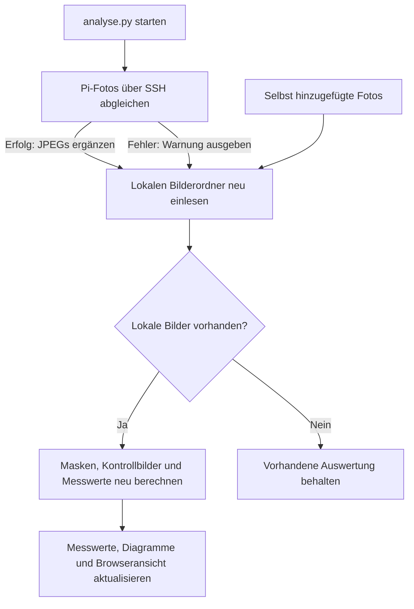

# BioBox · Bildanalyse und Pflanzenmonitoring

Bildgestützte Beobachtung von Pflanzen als Teil der Diplomarbeit **BioBox**. Aus Kameraaufnahmen werden sichtbare Blattflächen, Farbmerkmale und zeitliche Veränderungen ermittelt. Die Ergebnisse bilden eine Datengrundlage für die spätere Anbindung an die Webplattform und den digitalen Zwilling der Pflanze.

Dieses Repository dokumentiert den Teilbereich **Bildaufnahme, Bildauswertung und Zustandsbewertung** von **Atida Ashta** an der HTL Shkodra. Einstiegspunkt für die Verarbeitung ist `analyse.py`.

**Projektstatus:** Entwicklung und Validierung · Bildanalyse 4.13.0, Zustandsindex 4.1.0 · Stand 13.11.2026. Der Aufnahme- und Analyseablauf ist implementiert. Die Genauigkeit der Blattmasken und die fachliche Aussage des Zustandsindex werden weiter untersucht; die direkte Backend-Anbindung ist geplant.

## Inhalt

- [Projektziel und Funktionsumfang](#projektziel-und-funktionsumfang)
- [Verarbeitungsablauf](#verarbeitungsablauf)
- [Voraussetzungen und Installation](#voraussetzungen-und-installation)
- [Bedienung](#bedienung)
- [Messverfahren und Referenz](#messverfahren-und-referenz)
- [Ausgaben und Datenmodell](#ausgaben-und-datenmodell)
- [Konfiguration](#konfiguration)
- [Validierung und bekannte Grenzen](#validierung-und-bekannte-grenzen)
- [Roadmap](#roadmap)
- [Fehlerbehebung](#fehlerbehebung)
- [Dokumentation und Mitarbeit](#dokumentation-und-mitarbeit)

## Projektziel und Funktionsumfang

Die Entwicklung einer Pflanze soll anhand wiederholter Aufnahmen nachvollziehbar werden. Dafür werden messbare Bildmerkmale mit Aufnahmezeitpunkt, Qualitätsinformationen und einer eigenen Pflanzenreferenz verbunden. Im Mittelpunkt stehen die sichtbare Blattfläche und Veränderungen des Erscheinungsbildes.

Der lokale digitale Zwilling stellt die gespeicherten Bildmesswerte je Aufnahme dar. Die spätere Verknüpfung mit weiteren BioBox-Daten ist geplant.

### Verfügbare Funktionen

- Vorhandene Stundenfotos über SSH abgleichen; für eine Linealmessung bei Bedarf eine neue Aufnahme auslösen.
- Stündliche Aufnahmen direkt auf dem Pi einrichten, prüfen und ausschalten.
- Fertige Kamera-JPEGs abgleichen und lokal die neuesten **100 importierten Kameraaufnahmen** behalten.
- Alle lokalen Bilddateien auswerten, auch selbst hinzugefügte Fotos und bei fehlender Pi-Verbindung.
- Externe Bilddatensätze ohne gemeinsame Pflanzenzeitreihe untersuchen.
- Blattbereiche mit OpenCV erkennen und die Messmaske am Originalbild verfeinern.
- Ein einzelnes Kontrollbild pro lesbarer Aufnahme und eine binäre Blattmaske erzeugen.
- Blattpixel, kalibrierte Flächen und Ausdehnungen sowie Farb- und Qualitätsmerkmale bestimmen.
- Einen relativen Zustandsindex von 0 bis 100 mit Teilbewertungen und zeitlichem Verlauf berechnen.
- Ergebnisse als CSV und JSON sowie in fünf Analysediagrammen ausgeben.
- Messwerte im Browser ansehen, das Pflanzenmodell zur letzten Aufnahme drehen und seine Entwicklung für einen gewählten Zeitraum ansehen.
- Bereits vorhandene Aufnahmen mit einer neuen Skriptversion vollständig neu auswerten.

> Der Zustandsindex beschreibt sichtbare Veränderungen gegenüber der Referenz derselben Pflanze. **100 Punkte bedeuten eine geringe Abweichung zur Referenz.** Eine biologisch gesunde Pflanze oder eine bestimmte Krankheit wird damit nicht nachgewiesen.

## Verarbeitungsablauf



Der Fotoabruf und die lokale Analyse sind **zwei unabhängige Arbeitsschritte innerhalb desselben Skripts**. Sie werden nacheinander ausgeführt. Ein Timeout, ein fehlender SSH-Schlüssel oder eine abgelehnte Verbindung beendet nur den Abruf. Danach wird der konfigurierte lokale Bilderordner vollständig neu eingelesen und ausgewertet. Eine erfolgreiche Verbindung liefert ebenfalls keine eingeschränkte Analyseliste: Selbst hinzugefügte lokale Fotos werden mitverarbeitet.

Der Pi kann nach der Einrichtung selbstständig stündlich fotografieren. Die Übertragung und Bildanalyse werden auf dem auswertenden Computer gestartet. Eine stündliche Aufnahme auf dem Pi startet keine automatische Windows-Auswertung. Der geplante Backend-Versand ist noch nicht Bestandteil dieses Ablaufs.

### Verwendete Technik

| Technik | Aufgabe |
|---|---|
| Python | Aufnahmeabruf, Verarbeitung, Berechnung und Dateiverwaltung |
| OpenCV — Open Source Computer Vision Library | Farbverarbeitung, GrabCut, Maskenverfeinerung und geometrische Messungen |
| NumPy | Numerische Berechnungen und Verarbeitung der Bildarrays |
| Matplotlib | Erstellung der fünf Auswertungsdiagramme |
| Secure Shell (SSH) und Tailscale | Zugriff auf den Kamera-Pi über eine bestehende Verbindung |
| cron | Zeitgesteuerte Aufnahme direkt auf dem Raspberry Pi |

## Voraussetzungen und Installation

### Lokale Auswertung

Benötigt werden Python 3 mit `pip` und die Pakete `opencv-contrib-python`, `numpy` und `matplotlib`. Die folgenden Beispiele verwenden PowerShell unter Windows und werden im Projektverzeichnis ausgeführt.

```powershell
python -m venv .venv
.\.venv\Scripts\Activate.ps1
python -m pip install opencv-contrib-python numpy matplotlib
```

Die späteren `python`-Befehle setzen diese aktivierte Umgebung voraus. Alternativ kann direkt `.\.venv\Scripts\python.exe` als Interpreter verwendet werden, etwa wenn die PowerShell-Aktivierung blockiert ist.

Für interaktive Maskenkorrekturen und das Markieren einer Referenzstrecke wird eine grafische OpenCV-Installation benötigt. Eine reine Headless-Installation stellt diese Bildfenster nicht bereit.

### Kamera auf dem Raspberry Pi

Für den Kameraabruf werden zusätzlich benötigt:

- Ein eingerichteter Raspberry Pi mit funktionierender Kamera; der Referenzaufbau verwendet eine Camera Module 3 Wide.
- Ein OpenSSH-Client auf dem auswertenden Computer und ein erreichbarer SSH-Zugang zum Pi, im BioBox-Aufbau über Tailscale.
- Der vorhandene SSH-Schlüssel gemäß `PI_SSH_KEY`; dessen öffentlicher Schlüssel muss beim Pi-Benutzer hinterlegt sein. Ein geschützter Schlüssel muss im `ssh-agent` verfügbar sein.
- Der bestehende BioBox-Aufnahmehelfer `biobox-photo-test` mit der Option `--single`.
- Python 3 und das Linux-Werkzeug `flock` auf dem Pi; für den Stundenplan außerdem ein aktiver und beim Systemstart aktivierter `cron`-Dienst.

Die Kamera-Grundeinrichtung und der vorhandene Aufnahmehelfer werden vorausgesetzt. `analyse.py` richtet bei Bedarf den zusätzlichen Stundenauftrag ein. Für diesen Aufnahmeauftrag werden auf dem Pi keine OpenCV-Pakete benötigt.

Vor dem Fernzugriff sind die Pi-Adresse und die Pfade im [Konfigurationsbereich](#konfiguration) zu prüfen. Der Analyselauf verwendet `BatchMode=yes` und öffnet keinen Dialog für das Pi-Passwort. Der Standardschlüssel liegt unter `$env:USERPROFILE\.ssh\biobox_ed25519`. Bei einem bereits eingerichteten Schlüssel kann dieser in PowerShell in den laufenden Agent geladen werden:

```powershell
ssh-add "$env:USERPROFILE\.ssh\biobox_ed25519"
```

Die Einrichtung des Schlüssels und des Windows-Dienstes wird in der [Microsoft-Anleitung zu OpenSSH-Schlüsseln](https://learn.microsoft.com/en-us/windows-server/administration/openssh/openssh_keymanagement) beschrieben. Die lokale Auswertung mit `--lokal` benötigt keinen SSH-Zugang.

## Bedienung

### Vorhandene Bilder auswerten

Die Originalbilder werden in `bilder/` abgelegt. Anschließend wird die gesamte Auswahl neu verarbeitet:

```powershell
python analyse.py --lokal bilder --ausgabe auswertung
```

Unterstützt werden JPG/JPEG, PNG, BMP, TIFF und WebP. Bei einem lokalen Ordner werden die direkt darin liegenden Bilddateien ausgewählt.

### Normaler Start: Fotos abgleichen und lokal auswerten

```powershell
python analyse.py
```

Es werden bereits vorhandene fertige Stundenfotos vom Pi abgeholt. Eine zusätzliche Aufnahme wird bei diesem Aufruf **nicht** ausgelöst. Anschließend werden sämtliche unterstützten Bilddateien direkt im konfigurierten `BILDER_ORDNER` neu analysiert.

Der Standardpfad ist `Downloads/Diploma/bilder` im Benutzerverzeichnis. Er hängt nicht vom aktuellen PowerShell-Ordner ab. Bei einem anderen Projektstandort wird `BILDER_ORDNER` angepasst oder gezielt `python analyse.py --lokal bilder --ausgabe auswertung` ausgeführt.

| Fotoabruf | Lokaler Bildbestand | Verhalten |
|---|---|---|
| erfolgreich | Bilder vorhanden | Abgeholte und bereits vorhandene Fotos werden gemeinsam neu ausgewertet. |
| Timeout oder anderer Abruffehler | Bilder vorhanden | Fehlermeldung zum Abruf; die lokale Auswertung wird trotzdem durchgeführt. |
| erfolgreich oder fehlgeschlagen | keine Bilder vorhanden | Keine neue Auswertung; vorhandene Ergebnisse bleiben erhalten. |
| `--nur-bild` beim Pi-Abruf | beliebig | Nur Abruf; die Analyse wird ausdrücklich übersprungen. |

Bei einer erfolgreichen lokalen Auswertung endet der normale Aufruf mit Rückgabecode `0`, auch wenn der vorherige Abruf fehlgeschlagen ist. Bei fehlenden Bildern oder einem Analysefehler wird `1` zurückgegeben. Bei `--nur-bild` hängt der Rückgabecode allein vom Abruf ab: `0` bei Erfolg, `1` bei Fehler. Eine erfolgreiche Analyse bestätigt keine neuen Aufnahmen auf dem Pi.

### Stündliche Aufnahme einrichten

```powershell
python analyse.py --stundenaufnahme-einrichten
```

Vor der Aktivierung wird eine Testaufnahme geprüft. Bei Erfolg wird beim Pi-Benutzer ein eigener cron-Auftrag für **jede volle Stunde nach der Pi-Uhr** eingerichtet. Der Pi muss dafür eingeschaltet sein; der Windows-PC kann ausgeschaltet bleiben.

Bestehende andere Zeitplaneinträge werden erhalten. Wiederholtes Einrichten ersetzt den eigenen markierten BioBox-Auftrag. Bereits früher von Hand eingerichtete Aufnahmejobs werden nicht automatisch entfernt und sollten auf doppelte Aufnahmen geprüft werden. Der Stundenhelfer und die direkte Aufnahme zur Linealmessung verwenden eine gemeinsame Kamerasperre.

Status prüfen oder den eigenen Stundenauftrag ausschalten:

```powershell
python analyse.py --stundenaufnahme-status
python analyse.py --stundenaufnahme-ausschalten
```

Das Ausschalten erhält bereits gespeicherte Fotos. Ausfallzeiten des Pi können keine rückwirkenden Kameraaufnahmen erzeugen.

### Bereits aufgenommene Fotos abholen

```powershell
python analyse.py --abholen
```

Dieser Aufruf entspricht beim normalen Betrieb `python analyse.py`: Vorhandene fertige Aufnahmen werden abgeglichen, ohne ein zusätzliches Foto auszulösen. Danach werden alle lokalen Bilder neu ausgewertet, auch bei einem Abruffehler.

Es werden nur fehlende Kamera-JPEGs übertragen. Die Aufnahmereihenfolge ergibt sich aus dem UTC-Zeitstempel im Sitzungsnamen. Lokal bleiben höchstens die neuesten 100 verfügbaren importierten Kamerabilder; die Bereinigung erfolgt erst nach einem erfolgreichen Download. Bilder auf dem Pi und andere lokale Dateien werden dabei nicht gelöscht.

Nur übertragen, ohne neue Aufnahme und ohne Analyse:

```powershell
python analyse.py --abholen --nur-bild
```

`--nur-bild` ist für den Pi-Abruf vorgesehen und wird nicht mit `--lokal` oder einem lokalen Bildpfad kombiniert.

### Verschiedene Pflanzen oder Datensätze untersuchen

```powershell
python analyse.py --lokal datensatz --einzelbilder --ausgabe auswertung_datensatz
```

Dieser Modus liefert Einzelmessungen ohne gemeinsame Gesundheits- oder Wachstumszeitreihe. Aufnahmen verschiedener Pflanzen werden dadurch nicht als Verlauf einer einzigen Pflanze interpretiert.

### Masken prüfen und korrigieren

```powershell
python analyse.py --maske-korrigieren bilder/FOTO.jpg --ausgabe auswertung
```

`FOTO.jpg` wird durch den tatsächlichen Dateinamen ersetzt.

| Bedienung | Wirkung |
|---|---|
| Linke Maustaste | Blattbereich ergänzen |
| Rechte Maustaste | Hintergrund entfernen |
| `G` | GrabCut mit den gezeichneten Hinweisen erneut ausführen |
| `+` / `-` | Pinselgröße ändern |
| `U` | Letzte Änderung rückgängig machen |
| `R` | Anfangszustand wiederherstellen |
| Enter | Korrektur speichern |
| Esc | Ohne Speichern schließen |

Die Korrektur wird an den Inhalt der Originaldatei und das Objektivprofil gebunden. Nach dem Speichern wird der normale Analyselauf erneut gestartet. Die Korrektur wird für genau diese Aufnahme als Messmaske verwendet.

### Neue Skriptversion oder neue Pflanze

Bei jedem Lauf werden alle ausgewählten Aufnahmen, automatischen Masken und Zustandsvergleiche vollständig neu berechnet. Die Referenzen und die zeitliche Glättung werden dabei ausschließlich im Arbeitsspeicher aus der aktuellen Bildauswahl aufgebaut. Eine Prüfsumme der Skriptdatei wird im JSON als Herkunft des Verfahrens dokumentiert. Manuelle Korrekturen und der vorhandene Maßstab werden wiederverwendet.

Neue Masken, Kontrollbilder, Ergebnisse und Diagramme werden zunächst vollständig erstellt und anschließend gemeinsam übernommen. Bei einem Schreibfehler wird die vorherige Ausgabe wiederhergestellt; falls auch die Wiederherstellung blockiert wird, nennt die Fehlermeldung den erhaltenen Sicherungspfad. Parallel schreibende Analyseläufe im selben Ausgabeordner werden abgewiesen. Dafür wird keine `.analyse.lock` im Ausgabeordner angelegt.

Für eine andere Pflanze wird eine eigene Bildserie und eine eigene Kennung in `MESSREIHE` verwendet. `--neue-referenz` verlangt zusätzlich eine brauchbare Referenz in der Auswahl. Fehlt diese, bleibt die bisherige Auswertung erhalten:

```powershell
python analyse.py --lokal bilder --neue-referenz --ausgabe auswertung
```

### Gesundheitsansicht öffnen

Nach der Analyse kann `gesundheitssystem/gesundheitssystem.html` per Doppelklick geöffnet werden. Alternativ wird die Seite aus vorhandenen Ergebnissen ohne Pi-Abruf geöffnet:

```powershell
python analyse.py --gesundheit
```

Neben dem neuesten Foto werden Gesundheitsscore, Teilbewertungen, Warnungen und gemessene Blattmerkmale gezeigt. Der Verlauf verbindet ausschließlich Scores mit demselben Referenzbezug und Vergleichsverfahren. Eine nicht bewertbare letzte Aufnahme bleibt als solche sichtbar. Die vier Dateien werden automatisch erzeugt; beim Doppelklick wird kein Webserver benötigt.

### Digital Twin öffnen

Nach der Analyse wird die lokale Browseransicht geöffnet. Vorhandene Ergebnisse lassen sich auch ohne neue Analyse öffnen:

```powershell
python analyse.py --3d
python analyse.py --3d-aus-json auswertung/ergebnis.json
```

Der Browser zeigt die Pflanze aus der letzten Aufnahme. Aus den sichtbaren Konturen und Farben werden gewölbte Blattflächen aufgebaut. Ziehen dreht die Pflanze. Unter **Blätter zählen** werden dieselben Blätter einzeln und nummeriert angezeigt. Ein `≈` kennzeichnet die automatisch geschätzte Anzahl. Überlappende Blätter können bei der Erkennung zusammenfallen. Die Tiefe und verdeckte Pflanzenteile sind aus dem einzelnen Foto nicht messbar.

Mit dem Regler werden 0 bis 14 Tage nach der Aufnahme ausgewählt. Das Szenario verändert die Größe anhand einer geeigneten gemessenen Änderungsrate oder ersatzweise einer Annahme von 2 % pro Tag. Die Anzahl der dargestellten Blätter bleibt gleich. Die gemessene sichtbare Blattfläche steht weiterhin in den Ergebnissen.

Nach dem Austausch des Skripts werden vorhandene Fotos mit `python analyse.py --lokal bilder` neu ausgewertet. Ist die automatische Anzahl bei einem Foto ungenau, können die sichtbaren Blätter [einzeln markiert werden](dokumentation/BB-GUIDE-TWIN-001_A-M4_Digital-Twin-Modell.md#sichtbare-blätter-nachzählen).

## Messverfahren und Referenz

### Blattmaske

Die Blattkerne werden anhand der CIELAB-Farbachsen bestimmt. Kühle Halterungen und schwach grüne Bodenbereiche werden möglichst ausgeschlossen. Dünne Verbindungen werden nach ihrer Nähe zu breiten Blattflächen gefiltert. GrabCut verfeinert anschließend ein schmales Konturband am Original. Die Kontrollansicht zeigt genau diese Maske über dem Foto.

Gemessen wird die **sichtbare projizierte Blattfläche**. Überdeckte Blattteile werden nicht ergänzt. Blattstellung, Perspektive und Verdeckung können deshalb die gemessene Fläche verändern, ohne dass biologisches Wachstum stattgefunden hat.

### Physische Maße

Ohne verifizierten Maßstab werden Blattpixel ausgegeben. Für cm² und mm wird eine tatsächlich bekannte Strecke auf Höhe der Blattebene benötigt, beispielsweise ein dort liegendes Lineal:

```powershell
python analyse.py --massstab-bild bilder/FOTO.jpg --referenz-mm 50 --ausgabe auswertung
```

Die zwei Endpunkte der Strecke werden im Bild markiert. **50 mm ist ein Beispielwert und muss zur wirklich gemessenen Strecke passen.**

```text
s [mm/Pixel] = Referenzlänge [mm] / Abstand der markierten Punkte [Pixel]
Blattfläche [cm²] = Blattpixel × s² / 100
```

Die größte Ausdehnung der Blattmaske wird mit demselben Maßstab in Millimeter umgerechnet. Nach einer Änderung von Kamera- oder Blatthöhe muss der Maßstab überprüft werden. Geneigte Blätter und Blätter auf unterschiedlichen Höhen können mit einer einzelnen ebenen Referenz nur näherungsweise physisch vermessen werden.

Für die Wide-Optik kann zusätzlich eine passende Objektivkalibrierung mit Schachbrettaufnahmen erstellt werden:

```powershell
python analyse.py --kalibrieren kalibrierbilder
```

Das verwendete Muster und seine echte Feldgröße müssen zu den Einstellungen passen. Details und die weitere Marker-Alternative stehen in der [Bildaufnahme-Spezifikation](dokumentation/BB-SPEC-IMG-001_A-M1_Bilderfassungssystem.md).

### Relativer Zustandsindex

Für jede bestätigte Kameraansicht wird innerhalb des aktuellen Laufs eine eigene brauchbare Referenz im Arbeitsspeicher aufgebaut. Bei einer anderen Ansicht beginnt ein neuer Bezug mit dem ersten geeigneten Foto. Der Referenzstart erscheint bei 100 im Diagramm, zählt aber nicht als gemessener Zustandsvergleich. Farbe wird an übereinstimmenden Blattpositionen oder anhand geprüfter Blattfarbverteilungen verglichen. Der Index berücksichtigt auch lokale Verfärbungen, die den mittleren Grünton kaum verändern. Bei geeigneter Kamerageometrie und vollständigem Bildausschnitt fließt sichtbarer Flächenverlust ergänzend ein. Ein fester gesunder Basilikum-Grünton wird nicht vorausgesetzt.

Geeignete Lichtänderungen werden anhand des registrierten Hintergrunds ausgeglichen. Die Blattfarben werden nicht auf eine Sollfarbe gesetzt. Überbelichtete oder zu dunkle Vergleichsbereiche werden ausgeschlossen; bei ungleichmäßiger Helligkeit kann ein getrennt gekennzeichneter Teilvergleich über bestätigte Farbverhältnisse erfolgen. Dabei bleiben Braun- und Strukturwertung aus. Ohne verlässliche Farbreferenz wird kein Score ausgegeben. Die exportierten Rohfarbwerte bleiben lichtabhängig.

Berechnete Werte mit automatisch gewählter Referenz werden zunächst als `vorlaeufige_referenz` gekennzeichnet. Die Referenzaufnahme selbst hat den Status `referenzfoto_start_der_ansicht` und erhält keinen gemessenen Score. Bei einer ungültigen Aufnahme wird kein alter Score übernommen.

Es werden keine automatischen `referenz.npz`-Dateien und keine Dateien in `kamera_referenzen/` erzeugt oder eingelesen. Fällt das älteste Referenzfoto aus dem 100-Bilder-Fenster, wird beim nächsten Lauf eine neue Referenz aus den verbleibenden Bildern gewählt. Dadurch können sich der Beginn der Reihe und neu berechnete relative Scores ändern. Der Index bezieht sich damit auf die aktuelle Bildauswahl, nicht dauerhaft auf das erste jemals aufgenommene Foto.

### Zeitbezug

Aufnahmezeiten werden aus eindeutigen Zeitangaben im Dateinamen oder aus Foto-Metadaten (EXIF) mit vorhandenem Zeitzonenoffset gelesen und als Coordinated Universal Time (UTC, koordinierte Weltzeit) ausgegeben. Ein Download- oder Änderungsdatum wird nicht als Aufnahmezeit verwendet. Bei externen Bildern muss eine erkannte Zeitangabe im Dateinamen zum angenommenen UTC-Zeitbezug passen.

Wachstumsraten für die sichtbare Blattfläche sind bei vergleichbaren Aufnahmen ab 30 Minuten Abstand möglich. Abstände ab zwölf Stunden werden bevorzugt; kürzere werden gekennzeichnet, weil Maskenschwankungen stark ins Gewicht fallen. Leicht verschobene, bestätigte Ansichten können über ihren gemeinsamen Bildausschnitt verglichen werden. Bei einem Wechsel der Kameraansicht wird keine Wachstumsrate über den Wechsel berechnet. Die direkt gemessene Änderung in Blattpixeln pro Tag ist bei gleicher Bildauflösung trotzdem sichtbar und separat gekennzeichnet. Der 24-Stunden-Trend benötigt einen passenden Vergleich im selben Bewertungsmodus vor 22 bis 26 Stunden. Fehlt diese Grundlage, bleibt die entsprechende Angabe unbekannt. Kurze Zeitabstände können kleine Masken- oder Blattstellungsänderungen zu großen Tagesraten hochrechnen.

Wenn die tatsächliche Aufnahmezeit bekannt ist, aber nicht im Dateinamen oder in den Bildmetadaten steht, kann eine CSV-Datei mit den Spalten `bild;captured_at` verwendet werden. Beispiel:

```csv
bild;captured_at
foto.png;2026-11-12T10:30:00+01:00
```

```powershell
python analyse.py --lokal bilder --aufnahmezeiten aufnahmezeiten.csv
```

Die Zeitdatei ordnet bekannte Zeiten zu; ein Dateiänderungsdatum wird nicht als Aufnahmezeit angenommen.

## Ausgaben und Datenmodell

Die Grafiken `02_wachstumsrate.png` und `04_gesundheit.png` markieren jede Aufnahme im Statusbereich unter der Messkurve. Die Aufnahmenummer entspricht der Zeile in `ergebnis.csv` ohne Kopfzeile. Ein Kreuz ist ein fehlender Messwert mit Grund. Referenzstarts und reine Farbteilvergleiche werden im Zustandsindex gesondert markiert. Teilbewertungen werden in Grafik 05 je Aufnahme angezeigt. Die Konsole nennt nach der Auswertung die Anzahl berechneter Werte.

### Dateien

| Pfad | Inhalt |
|---|---|
| `analyse.py` | Zentraler Einstieg für Aufnahmeabruf, Analyse, Bewertung und Diagramme |
| `dokumentation/` | Spezifikationen zu Aufnahme, Bewertung und Messfeldern |
| `bilder/` | Lokale Eingabebilder im üblichen Projektaufbau |
| `auswertung/masken/` | Binäre Messmasken in Originalauflösung |
| `auswertung/kontrolle/` | Je eine Kontrollansicht pro lesbarer Aufnahme, Foto bis 1500 Pixel breit |
| `auswertung/grafiken/` | Fünf Auswertungsdiagramme |
| `auswertung/ergebnis.csv` | Tabellarische Kontrollausgabe |
| `auswertung/ergebnis.json` | Strukturierte Datensätze für die weitere Verarbeitung |
| `digital twin/digital_twin.json` | Modellzustand, 24-Stunden-Projektion und Prognosehistorie, sofern verfügbar |
| `digital twin/digital_twin_3d.html` mit `digital_twin_3d.js` und `digital_twin_3d.css` | Lokale Browseransicht, JavaScript und Gestaltung |
| `gesundheitssystem/gesundheitssystem.html`, `.css`, `.js`, `.json` | Lokale Gesundheitsansicht und zugehörige Daten |
| `auswertung/massstab.npz` | Gespeicherte Referenzstrecke, sofern eingerichtet |
| `auswertung/masken_korrektur/` | Dateigenaue manuelle Maskenkorrekturen |
| `auswertung/blattlabels/` | Optionale Blattmarkierungen und importierte Blattlabels |
| `kamera_kalibrierung.json` | Objektivprofil, sofern erstellt |

Die Ausgabeordner werden bei der Verarbeitung erzeugt. Beim Pi-Abruf gilt der konfigurierte `BILDER_ORDNER`; bei lokalen Aufrufen kann `--ausgabe` den Zielordner festlegen. Ohne diese Option liegt `auswertung/` neben dem ausgewählten Bilderordner. Die Ordner `digital twin/` und `gesundheitssystem/` liegen neben dem Standardordner `auswertung/`. Bei einem anders benannten Ausgabeordner werden sie darin getrennt von anderen Messreihen erzeugt. Alte Twin-Dateien in `auswertung/` werden nach einem erfolgreichen Lauf übernommen; gespeicherte Prognosen bleiben erhalten. Maßstab und manuelle Korrekturen gehören zum jeweiligen Messaufbau. Frühere automatisch erzeugte Referenzdateien werden nach einem erfolgreichen Lauf gezielt entfernt.

### Diagramme

| Datei | Darstellung |
|---|---|
| `01_wachstum.png` | Sichtbare Blattfläche in cm² bei gültigem Maßstab, sonst in Pixeln |
| `02_wachstumsrate.png` | Geometrisch geprüfte Rate, separate direkte Änderung in Pixel/Tag und Status je Aufnahme |
| `03_farbverlauf.png` | Rohfarben sowie Gelb- und Braunanteile |
| `04_gesundheit.png` | Relativer Zustandsindex und zeitlicher Verlauf |
| `05_teilscores.png` | Teilbewertungen je Aufnahme; fehlende Werte bleiben sichtbar |

Die fünf Diagramme werden auch bei fehlenden Einzelwerten erstellt. Fehlende Daten werden als solche dargestellt.

### Datensätze und fehlende Werte

Bei vorhandenen Originalen werden die Messungen neu berechnet. Für ältere Aufnahmen ohne Original bleiben die Werte aus der gespeicherten Historie erhalten. Wenn dieselbe Aufnahme in JSON und CSV vorhanden ist, gelten die JSON-Werte. Datensätze, die nur in der CSV stehen, bleiben als historische Einträge erhalten.

Pro ausgewähltem Eingabebild wird ein Datensatz erzeugt. Auch eine unlesbare oder nicht auswertbare Datei bleibt mit ihrem Fehlerstatus enthalten.

CSV bedeutet Comma-Separated Values, ein tabellarisches Textformat. Die Kontrollausgabe verwendet hier Semikolon, Dezimalkomma und UTF-8 mit Byte Order Mark (BOM), einer Codierungskennung für Tabellenprogramme. Fehlende Werte werden als `Nicht verfügbar` gekennzeichnet. Der Grund steht in `fehlende_werte`. Keine erkannten Warnungen werden mit `Keine` bezeichnet. Eine gemessene Null bleibt die Zahl `0`.

JSON bedeutet JavaScript Object Notation. `ergebnis.json` enthält eine Liste mit einem Datensatz je Bild. Verwendet werden echte Zahlen und boolesche Werte. Nicht verfügbare Felder werden ausgelassen; ihre fachlichen Gründe stehen unter `analysis.missing_values`. Die API — Application Programming Interface, also Programmierschnittstelle — soll später diese strukturierten Daten übernehmen; ein Einlesen der CSV ist dafür nicht vorgesehen.

| JSON-Bereich | Inhalt |
|---|---|
| `device_id` | Gerätezuordnung, bis zur bestätigten Plattform-ID ausgelassen |
| `image` | Dateiname, Aufnahmezeit, relativer Bildpfad und Dateiprüfsumme |
| `image_measurements` | Flächen-, Farb-, Geometrie- und Qualitätsmesswerte |
| `health_assessment` | Zustandsindex, Teilbewertungen, Status und Scoring-Version |
| `analysis` | Herkunft, Referenzbezug, Skriptstand und Gründe für fehlende Werte |

Pixel- und Farbwerte bleiben ohne Maßstab verfügbar. Metrische Werte und fehlende Vergleichsscores werden nicht geschätzt. Fehlt bei älteren Daten ein aus derselben Aufnahme eindeutig ableitbarer Wert, werden Blattanteil, metrische Maße oder Farbcode aus den gespeicherten Eingangsgrößen ergänzt.

Aufnahme und Skript werden mit SHA-256-Prüfsummen — Secure Hash Algorithm mit 256 Bit — gekennzeichnet. `pipeline_version`, `scoring_version` und `analysis.pipeline_sha256` machen den Verarbeitungsstand nachvollziehbar. Der abgeleitete Bildpfad muss bei der späteren Serveranbindung mit den tatsächlichen Speicherpfaden abgeglichen werden.

Die vollständigen Feldnamen, Einheiten und Zuordnungen stehen im [Merkmalsverzeichnis](dokumentation/BB-REF-MERKMALE-001_A-M2_Computer-Vision-Pipeline.md). Ein automatischer Versand an die Webplattform ist noch nicht implementiert.

## Konfiguration

Die Einstellungen stehen im oberen Bereich von `analyse.py`. Es wird derzeit keine separate Konfigurationsdatei eingelesen.

| Einstellung | Bedeutung |
|---|---|
| `PI_ADRESSE` | SSH-Benutzer und erreichbare Adresse des Kamera-Pi |
| `PI_AUFNAHME` | Absoluter Aufruf des vorhandenen Aufnahmehelfers |
| `PI_FOTO_ORDNER` | Verzeichnis mit fertigen Kamera-Sitzungen auf dem Pi |
| `PI_SSH_KEY` | Pfad zum vorhandenen privaten SSH-Schlüssel; bei Passwortschutz im `ssh-agent` laden |
| `BILDER_ORDNER` | Lokales Ziel des Pi-Abgleichs |
| `MAX_KAMERA_BILDER` | Begrenzung der lokal aufbewahrten importierten Kamerabilder; Standard: 100 |
| `MESSREIHE` | Kennung der untersuchten Pflanze beziehungsweise Beobachtungsreihe |
| `REFERENZ_FREIGEGEBEN` | Freigabekennzeichnung der Hauptreferenz nach Sichtprüfung; keine biologische Bestätigung |
| `DEVICE_ID` | Bestätigter Geräteschlüssel für die spätere Plattformzuordnung |
| `ROI_NORMIERT` | Optionaler normierter Bildbereich |

Der Standard für `BILDER_ORDNER` ist `Downloads/Diploma/bilder` im Benutzerverzeichnis. Bei einem anderen Projektstandort wird dieser Pfad angepasst. Kameraadressen, Kennungen und Kalibrierdaten müssen zum jeweiligen Aufbau passen. Persönliche Zugangsdaten gehören nicht in die Projektdateien.

Alle verfügbaren Optionen werden mit folgendem Befehl angezeigt:

```powershell
python analyse.py --help
```

## Validierung und bekannte Grenzen

| Meilenstein | Technischer Nachweis mit diesem Stand | Vor der praktischen Abnahme |
|---|---|---|
| A-M1 · Bilderfassungssystem | Ein echtes BioBox-Original wurde lokal eingelesen und ausgewertet. | Kameraansicht und Bildqualität am endgültigen Aufbau prüfen. Die automatische Aufnahme separat einrichten und am Pi testen. |
| A-M2 · Computer-Vision-Pipeline | Maske, eine Kontrollansicht je lesbarem Bild, Pixel- und Maßstabsrechnung, CSV/JSON und fünf Grafiken wurden geprüft. | Originale des Endaufbaus sichten und Blattflächen mit einem Maßstab auf Blatthöhe kontrollieren. |
| A-M3 · Gesundheitsbewertungssystem | Der Index wurde an kontrollierten Lichtvarianten, simulierter Gelb-/Braunfärbung und ungeeigneten Aufnahmen geprüft. | Eine eigene Folge realer Aufnahmen derselben Pflanze mit überprüfter Referenz auswerten. |

Für Version 4.4.1 wurden 13 lokale Regressionstests für den getrennten Abruf- und Analyseablauf erfolgreich ausgeführt. Dazu gehörten simulierte SSH-Timeouts und Abruffehler, neu hinzugefügte lokale Bilder, die ausdrückliche Offline-Auswertung, der reine Download und ein leerer Bildbestand. Ein vollständiger Verarbeitungstest mit künstlichen Pflanzenbildern bestätigte, dass nach einem Timeout beide Bilddatensätze, die Masken, die Kontrollbilder und alle fünf Grafiken neu erzeugt und alte Ausgaben ersetzt wurden.

Frühere Entwicklungsprüfungen verwendeten ein BioBox-Original und künstliche Licht- und Farbvarianten. Solche Versuche ersetzen keine Prüfung der Messgenauigkeit am endgültigen Aufbau. Für diese Dokumentationsaktualisierung wurde keine neue Live-Verbindung zum Pi und keine neue biologische Bewertung getestet.

| Prüfbereich | Erwartetes Verhalten |
|---|---|
| Reine Belichtungsänderung | Möglichst stabiler Zustandsindex bei unverändertem Pflanzenbild |
| Echte sichtbare Verfärbung | Nachvollziehbare Änderung der passenden Teilbewertungen |
| Ungeeigneter Lichtvergleich | Fehlender Score mit erklärtem Status |
| Fehlender Maßstab | Pixelmessung verfügbar, physische Maße unbekannt |
| Geänderte Kamerageometrie | Ungeeignete Wachstumsvergleiche werden unterdrückt |
| Neuer Lauf oder neue Skriptdatei | Alle ausgewählten Aufnahmen, Masken und Vergleiche werden erneut berechnet |
| Abruffehler bei vorhandenen lokalen Bildern | Lokale Analyse mit vollständiger neuer Dateiauswahl wird fortgesetzt |
| Neue lokale Fotos bei erfolgreichem Abruf | Werden gemeinsam mit den Kameraimporten analysiert |
| Kein lokales Bild | Vorhandene Auswertung bleibt erhalten |
| Gesperrte Ausgabedatei | Vorherige zusammengehörige Ausgabe bleibt erhalten |

Helle Blattzeichnungen, Schatten, ähnliche Hintergrundfarben, schmale Blätter und Verdeckungen bleiben anspruchsvolle Fälle. Eine automatische Maske kann dabei fehlerhaft sein und muss am Kontrollbild überprüft werden. Das Messverfahren erfasst weder verdeckte Blattflächen noch Pflanzenhöhe oder die dreidimensionale Blattoberfläche.

## Roadmap

Die folgenden Schritte beschreiben die geplante Weiterentwicklung. Sie sind noch keine zugesicherten Funktionen.

| Bereich | Nächster Entwicklungsschritt | Ziel der Prüfung |
|---|---|---|
| Segmentierung | Reale Testserien mit unterschiedlichen Pflanzen, Blattzeichnungen, Hintergründen und Lichtbedingungen aufbauen | Abweichung zu unabhängig markierten Blattgrenzen bestimmen und verringern |
| Physische Messung | Kalibrierte Aufnahmen mit echten Referenzmessungen vergleichen | Flächenfehler und Einfluss von Perspektive und Blatthöhe dokumentieren |
| Zustandsbewertung | Längere Beobachtungsreihen mit protokolliertem Pflanzenzustand auswerten | Parameter und Aussage des relativen Index fachlich prüfen |
| Datenübergabe | Einen versionierten API-Vertrag mit Geräte-, Bild- und Referenzzuordnung umsetzen | Übertragung mit Fehlerbehandlung und Wiederholung ohne doppelte Datensätze |
| Umweltbezug | Zeitlich passende Sensorwerte mit den Bildbeobachtungen verknüpfen | Veränderungen im Zusammenhang mit den Aufnahme- und Umweltbedingungen darstellen |
| Digitaler Zwilling | Zeitlich passende Sensordaten mit den vorhandenen Bildmesswerten verknüpfen | Nachvollziehbarer gemeinsamer Zeitbezug von Bildern und Zustandsdaten |
| Wartbarkeit | Konfiguration auslagern, Aufnahmeintervalle konfigurierbar machen und Regressionstests im Repository verankern | Reproduzierbare Einrichtung und überprüfbare Änderungen |

CSV kann als lokale Kontrollansicht erhalten bleiben. Die spätere Datenbankübergabe soll direkt aus den strukturierten Ergebnissen erfolgen. Neue Funktionen werden mit ihren Messannahmen, Versionsänderungen und Prüfergebnissen dokumentiert.

## Fehlerbehebung

| Beobachtung | Nächster Prüfschritt |
|---|---|
| Keine Bilder gefunden | Eingabepfad und unterstützte Dateiendungen prüfen; beim lokalen Ordner Bilder direkt darin ablegen |
| SSH-Verbindung scheitert | Vorhandene lokale Bilder werden trotzdem ausgewertet. Für neue Pi-Fotos Erreichbarkeit, Tailscale, Benutzer und SSH-Schlüssel prüfen. |
| Schlüsseldatei fehlt oder Agent kann sie nicht verwenden | `PI_SSH_KEY` prüfen und den eingerichteten Schlüssel mit `ssh-add` laden; lokal bleibt `--lokal bilder` verfügbar. |
| Stundenauftrag wird nicht eingerichtet | Ausgabe der Testaufnahme prüfen; auf dem Pi Verfügbarkeit, Aktivität und Startfreigabe von cron prüfen |
| cm² oder mm fehlen | Tatsächliche Referenzstrecke in der Blattebene einrichten und passenden Maßstab prüfen |
| Scores ändern sich nach dem Wegfall alter Fotos | Die aktuelle Auswahl bildet die Referenz neu. Referenzdateiname im Datensatz prüfen. |
| Ergebnisdateien können nicht ersetzt werden | `ergebnis.csv` in Excel und offene Ausgabedateien schließen; Analyse erneut starten |
| Maske enthält Hintergrund oder lässt Blätter aus | Original und Kontrollbild vergleichen; gegebenenfalls die dateigenaue Korrekturfunktion nutzen |
| Altes Objektivprofil enthält keine Bildgröße | Eine passende Kalibrierung mit `--kalibrieren` neu erstellen |
| Interaktives Bildfenster fehlt | Grafische OpenCV-Installation und lokale Bildschirmausgabe prüfen |

Für einen Fehlerbericht helfen der verwendete Befehl, Python- und Paketversionen, die betreffende Originalaufnahme, das zugehörige Kontrollbild und die relevante Fehlermeldung. Ein Statushinweis allein beschreibt noch nicht die Ursache einer Pflanzenveränderung.

## Dokumentation und Mitarbeit

| Dokument | Schwerpunkt |
|---|---|
| [Bildaufnahme-Spezifikation](dokumentation/BB-SPEC-IMG-001_A-M1_Bilderfassungssystem.md) | Aufnahmebetrieb, Segmentierung und physische Messung |
| [Gesundheitsbewertung](dokumentation/BB-SPEC-HEALTH-001_A-M3_Gesundheitsbewertung.md) | Referenz, Lichtausgleich, Teilbewertungen und Zustandsindex |
| [Merkmalsverzeichnis](dokumentation/BB-REF-MERKMALE-001_A-M2_Computer-Vision-Pipeline.md) | Datentypen, Einheiten, fehlende Werte und Exportzuordnung |
| [Digital-Twin-Modell](dokumentation/BB-GUIDE-TWIN-001_A-M4_Digital-Twin-Modell.md) | Browseransicht, Messwerte und Projektion |

Änderungen sollen an passenden Originalbildern überprüft und in verständlichen, zusammengehörigen Commits dokumentiert werden. Bei Änderungen des Messverfahrens oder der Bewertung werden die zugehörigen Versionsfelder und Spezifikationen gepflegt.

Wenn die erzeugten Viewer-Dateien im Repository liegen, können sie über diese Einträge in `.gitattributes` von GitHubs Sprachstatistik ausgeschlossen werden:

```gitattributes
"digital twin/**" linguist-generated=true
gesundheitssystem/** linguist-generated=true
```

Große Bilddatensätze, automatisch erzeugte Ausgaben und die virtuelle Python-Umgebung werden von der Quellcode-Versionierung getrennt gehalten. Kleine gezielte Prüfdaten und ihre Herkunft können die spätere Regressionstest-Sammlung ergänzen. Gerätebezogene Kalibrierdaten und geprüfte Maskenkorrekturen gehören zum jeweiligen Messaufbau. Automatische Pflanzenreferenzen bestehen nur während eines Analyselaufs.

**Autorin:** Atida Ashta · **Projekt:** BioBox · **Teilbereich:** Bildaufnahme, Bildanalyse und Pflanzenmonitoring
