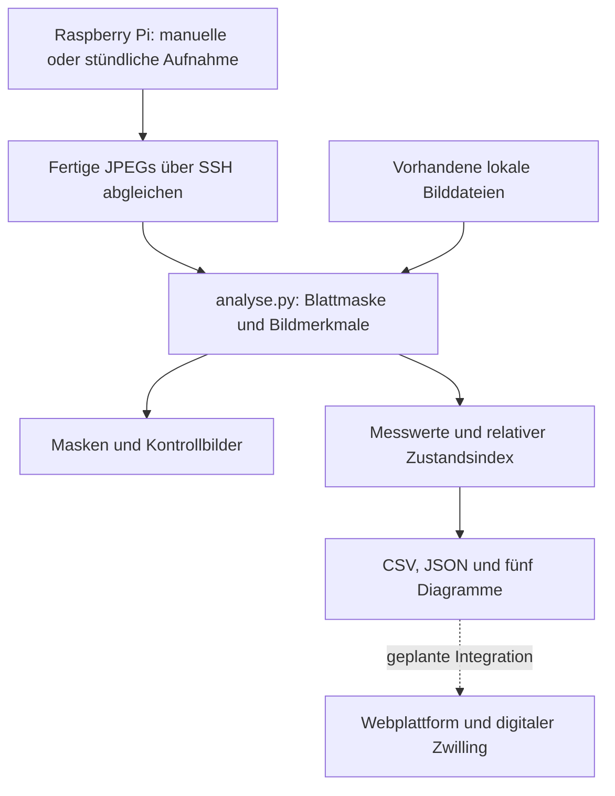

# BioBox · Bildanalyse und Pflanzenmonitoring

Bildgestützte Beobachtung von Pflanzen als Teil der Diplomarbeit **BioBox**. Aus Kameraaufnahmen werden sichtbare Blattflächen, Farbmerkmale und zeitliche Veränderungen ermittelt. Die Ergebnisse bilden eine Datengrundlage für die spätere Anbindung an die Webplattform und den digitalen Zwilling der Pflanze.

Dieses Repository dokumentiert den Teilbereich **Bildaufnahme, Bildauswertung und Zustandsbewertung** von **Atida Ashta** an der HTL Shkodra. Einstiegspunkt für die Verarbeitung ist `analyse.py`.

**Projektstatus:** Entwicklung und Validierung. Der Aufnahme- und Analyseablauf ist implementiert. Die Genauigkeit der Blattmasken und die fachliche Aussage des Zustandsindex werden weiter untersucht; die direkte Backend-Anbindung ist geplant.

## Inhalt

- [Projektziel und Funktionsumfang](#projektziel-und-funktionsumfang)
- [Verarbeitungsablauf](#verarbeitungsablauf)
- [Voraussetzungen und Installation](#voraussetzungen-und-installation)
- [Bedienung](#bedienung)
- [Messverfahren und Referenz](#messverfahren-und-referenz)
- [Ausgaben und Datenmodell](#ausgaben-und-datenmodell)
- [Konfiguration](#konfiguration)
- [Validierung und bekannte Grenzen](#validierung-und-bekannte-grenzen)
- [Roadmap](#roadmap)
- [Fehlerbehebung](#fehlerbehebung)
- [Dokumentation und Mitarbeit](#dokumentation-und-mitarbeit)

## Projektziel und Funktionsumfang

Die Entwicklung einer Pflanze soll anhand wiederholter Aufnahmen nachvollziehbar werden. Dafür werden messbare Bildmerkmale mit Aufnahmezeitpunkt, Qualitätsinformationen und einer eigenen Pflanzenreferenz verbunden. Im Mittelpunkt stehen die sichtbare Blattfläche und Veränderungen des Erscheinungsbildes.

Der digitale Zwilling soll diese Beobachtungen später zusammen mit weiteren BioBox-Daten zeitlich zugeordnet darstellen. In diesem Repository wird dafür die bildbasierte Datenerfassung und Auswertung bereitgestellt.

### Verfügbare Funktionen

- Neue Kameraaufnahme über den vorhandenen BioBox-Helfer auf dem Raspberry Pi auslösen.
- Stündliche Aufnahmen direkt auf dem Pi einrichten, prüfen und ausschalten.
- Fertige Kamera-JPEGs abgleichen und lokal die neuesten **100 importierten Kameraaufnahmen** behalten.
- Vorhandene lokale Bilder und externe Bilddatensätze auswerten.
- Blattbereiche mit OpenCV erkennen und die Messmaske am Originalbild verfeinern.
- Ein einzelnes Kontrollbild pro lesbarer Aufnahme und eine binäre Blattmaske erzeugen.
- Blattpixel, kalibrierte Flächen und Ausdehnungen sowie Farb- und Qualitätsmerkmale bestimmen.
- Einen relativen Zustandsindex von 0 bis 100 mit Teilbewertungen und zeitlichem Verlauf berechnen.
- Ergebnisse als CSV und JSON sowie in fünf Diagrammen ausgeben.
- Bereits vorhandene Aufnahmen mit einer neuen Skriptversion vollständig neu auswerten.

> Der Zustandsindex beschreibt sichtbare Veränderungen gegenüber der Referenz derselben Pflanze. **100 Punkte bedeuten eine geringe Abweichung zur Referenz.** Eine biologisch gesunde Pflanze oder eine bestimmte Krankheit wird damit nicht nachgewiesen.

## Verarbeitungsablauf



Aufnahme und Auswertung laufen getrennt: Der Pi kann nach der Einrichtung selbstständig fotografieren. Die Übertragung und Bildanalyse werden auf dem auswertenden Computer gestartet. Eine stündliche Aufnahme auf dem Pi startet keine automatische Windows-Auswertung.

### Verwendete Technik

| Technik | Aufgabe |
|---|---|
| Python | Aufnahmeabruf, Verarbeitung, Berechnung und Dateiverwaltung |
| OpenCV — Open Source Computer Vision Library | Farbverarbeitung, GrabCut, Maskenverfeinerung und geometrische Messungen |
| NumPy | Numerische Berechnungen und Verarbeitung der Bildarrays |
| Matplotlib | Erstellung der fünf Auswertungsdiagramme |
| Secure Shell (SSH) und Tailscale | Zugriff auf den Kamera-Pi über eine bestehende Verbindung |
| cron | Zeitgesteuerte Aufnahme direkt auf dem Raspberry Pi |

## Voraussetzungen und Installation

### Lokale Auswertung

Benötigt werden Python 3 mit `pip` und die Pakete `opencv-contrib-python`, `numpy` und `matplotlib`. Die folgenden Beispiele verwenden PowerShell unter Windows und werden im Projektverzeichnis ausgeführt.

```powershell
python -m venv .venv
.\.venv\Scripts\Activate.ps1
python -m pip install opencv-contrib-python numpy matplotlib
```

Die späteren `python`-Befehle setzen diese aktivierte Umgebung voraus. Alternativ kann direkt `.\.venv\Scripts\python.exe` als Interpreter verwendet werden, etwa wenn die PowerShell-Aktivierung blockiert ist.

Für interaktive Maskenkorrekturen und das Markieren einer Referenzstrecke wird eine grafische OpenCV-Installation benötigt. Eine reine Headless-Installation stellt diese Bildfenster nicht bereit.

### Kamera auf dem Raspberry Pi

Für den Kameraabruf werden zusätzlich benötigt:

- Ein eingerichteter Raspberry Pi mit funktionierender Kamera; der Referenzaufbau verwendet eine Camera Module 3 Wide.
- Ein OpenSSH-Client auf dem auswertenden Computer und ein erreichbarer SSH-Zugang zum Pi, im BioBox-Aufbau über Tailscale.
- Der bestehende BioBox-Aufnahmehelfer `biobox-photo-test` mit der Option `--single`.
- Python 3 und das Linux-Werkzeug `flock` auf dem Pi; für den Stundenplan außerdem ein aktiver und beim Systemstart aktivierter `cron`-Dienst.

Die Kamera-Grundeinrichtung und der vorhandene Aufnahmehelfer werden vorausgesetzt. `analyse.py` richtet bei Bedarf den zusätzlichen Stundenauftrag ein. Für diesen Aufnahmeauftrag werden auf dem Pi keine OpenCV-Pakete benötigt.

Vor dem Fernzugriff sind die Pi-Adresse und die Pfade im [Konfigurationsbereich](#konfiguration) zu prüfen.

## Bedienung

### Vorhandene Bilder auswerten

Die Originalbilder werden in `bilder/` abgelegt. Anschließend wird die gesamte Auswahl neu verarbeitet:

```powershell
python analyse.py --lokal bilder --ausgabe auswertung
```

Unterstützt werden JPG/JPEG, PNG, BMP, TIFF und WebP. Bei einem lokalen Ordner werden die direkt darin liegenden Bilddateien ausgewählt.

### Neue Aufnahme mit anschließender Analyse

```powershell
python analyse.py
```

Der konfigurierte Pi-Aufnahmehelfer wird ausgeführt. Danach werden fehlende fertige JPEGs abgeholt und die ausgewählten Kamerabilder analysiert. Ein Pi-Passwort wird bei Bedarf von SSH abgefragt.

### Stündliche Aufnahme einrichten

```powershell
python analyse.py --stundenaufnahme-einrichten
```

Vor der Aktivierung wird eine Testaufnahme geprüft. Bei Erfolg wird beim Pi-Benutzer ein eigener cron-Auftrag für **jede volle Stunde nach der Pi-Uhr** eingerichtet. Der Pi muss dafür eingeschaltet sein; der Windows-PC kann ausgeschaltet bleiben.

Bestehende andere Zeitplaneinträge werden erhalten. Wiederholtes Einrichten erzeugt keinen zweiten eigenen Auftrag. Der Stundenhelfer und der manuelle Aufnahmeweg dieses Skripts verwenden eine gemeinsame Kamerasperre.

Status prüfen oder den eigenen Stundenauftrag ausschalten:

```powershell
python analyse.py --stundenaufnahme-status
python analyse.py --stundenaufnahme-ausschalten
```

Das Ausschalten erhält bereits gespeicherte Fotos. Ausfallzeiten des Pi können keine rückwirkenden Kameraaufnahmen erzeugen.

### Bereits aufgenommene Fotos abholen

```powershell
python analyse.py --abholen
```

Vorhandene fertige Aufnahmen werden aus dem konfigurierten Pi-Bilderordner abgeglichen. Dabei wird kein zusätzliches Foto ausgelöst. Anschließend werden die lokalen Kamerabilder erneut ausgewertet.

Es werden nur fehlende Kamera-JPEGs übertragen. Die Aufnahmereihenfolge ergibt sich aus dem UTC-Zeitstempel im Sitzungsnamen. Lokal bleiben höchstens die neuesten 100 verfügbaren importierten Kamerabilder; die Bereinigung erfolgt erst nach einem erfolgreichen Download. Bilder auf dem Pi und andere lokale Dateien werden dabei nicht gelöscht.

Nur übertragen, ohne neue Aufnahme und ohne Analyse:

```powershell
python analyse.py --abholen --nur-bild
```

### Verschiedene Pflanzen oder Datensätze untersuchen

```powershell
python analyse.py --lokal datensatz --einzelbilder --ausgabe auswertung_datensatz
```

Dieser Modus liefert Einzelmessungen ohne gemeinsame Gesundheits- oder Wachstumszeitreihe. Aufnahmen verschiedener Pflanzen werden dadurch nicht als Verlauf einer einzigen Pflanze interpretiert.

### Masken prüfen und korrigieren

```powershell
python analyse.py --maske-korrigieren bilder/FOTO.jpg --ausgabe auswertung
```

`FOTO.jpg` wird durch den tatsächlichen Dateinamen ersetzt.

| Bedienung | Wirkung |
|---|---|
| Linke Maustaste | Blattbereich ergänzen |
| Rechte Maustaste | Hintergrund entfernen |
| `G` | GrabCut mit den gezeichneten Hinweisen erneut ausführen |
| `+` / `-` | Pinselgröße ändern |
| `U` | Letzte Änderung rückgängig machen |
| `R` | Anfangszustand wiederherstellen |
| Enter | Korrektur speichern |
| Esc | Ohne Speichern schließen |

Die Korrektur wird an den Inhalt der Originaldatei und das Objektivprofil gebunden. Nach dem Speichern wird der normale Analyselauf erneut gestartet. Die Korrektur wird für genau diese Aufnahme als Messmaske verwendet.

### Neue Skriptversion oder neue Pflanze

Bei Codeänderungen werden auch ältere ausgewählte Aufnahmen neu ausgewertet. Die automatische Referenzmaske wird erneut berechnet; ein Prüfwert der Skriptdatei erkennt Änderungen auch bei gleicher Versionsnummer. Veraltete Scorehistorien werden bei einem geänderten Verfahren verworfen. Manuelle Korrekturen und der vorhandene Maßstab werden erhalten.

Neue Masken, Kontrollbilder, Ergebnisse und Diagramme werden zunächst vollständig erstellt und anschließend gemeinsam übernommen. Bei einem Schreibfehler wird die vorherige Ausgabe wiederhergestellt. Parallel schreibende Analyseläufe im selben Ausgabeordner werden abgewiesen.

Für eine andere Pflanze wird eine eigene Bildserie und eine eigene Kennung in `MESSREIHE` verwendet. Eine Referenz für die ausgewählte neue Serie kann bewusst neu gebildet werden:

```powershell
python analyse.py --lokal bilder --neue-referenz --ausgabe auswertung
```

## Messverfahren und Referenz

### Blattmaske

Die Verarbeitung verwendet Farbhinweise, GrabCut zur Vordergrund-/Hintergrundtrennung und geometrische Prüfungen. Berücksichtigt werden unter anderem helle Blattzeichnungen, große Hintergrundflächen, gerade Halterungen und dünne Stielverbindungen. Die unsicheren Blattgrenzen werden am Originalbild verfeinert.

Gemessen wird die **sichtbare projizierte Blattfläche**. Überdeckte Blattteile werden nicht ergänzt. Blattstellung, Perspektive und Verdeckung können deshalb die gemessene Fläche verändern, ohne dass biologisches Wachstum stattgefunden hat.

### Physische Maße

Ohne verifizierten Maßstab werden Blattpixel ausgegeben. Für cm² und mm wird eine tatsächlich bekannte Strecke auf Höhe der Blattebene benötigt, beispielsweise ein dort liegendes Lineal:

```powershell
python analyse.py --massstab-bild bilder/FOTO.jpg --referenz-mm 50 --ausgabe auswertung
```

Die zwei Endpunkte der Strecke werden im Bild markiert. **50 mm ist ein Beispielwert und muss zur wirklich gemessenen Strecke passen.**

```text
s [mm/Pixel] = Referenzlänge [mm] / Abstand der markierten Punkte [Pixel]
Blattfläche [cm²] = Blattpixel × s² / 100
```

Die größte Ausdehnung der Blattmaske wird mit demselben Maßstab in Millimeter umgerechnet. Nach einer Änderung von Kamera- oder Blatthöhe muss der Maßstab überprüft werden. Geneigte Blätter und Blätter auf unterschiedlichen Höhen können mit einer einzelnen ebenen Referenz nur näherungsweise physisch vermessen werden.

Für die Wide-Optik kann zusätzlich eine passende Objektivkalibrierung mit Schachbrettaufnahmen erstellt werden:

```powershell
python analyse.py --kalibrieren kalibrierbilder
```

Das verwendete Muster und seine echte Feldgröße müssen zu den Einstellungen passen. Details und die weitere Marker-Alternative stehen in der [Bildaufnahme-Spezifikation](Dokumentation/BB-SPEC-IMG-001_Bildaufnahme-Spezifikation.md).

### Relativer Zustandsindex

Als Referenz wird die erste brauchbare Aufnahme einer Messreihe gespeichert. Verglichen werden Farbverteilung, normierter Grünanteil, Gelb-/Braunzunahme, Farbsättigung und Farbton. Bei geeigneter Kamerageometrie werden außerdem Flächen- und Formänderungen berücksichtigt. Es wird kein fester „gesunder Basilikum-Grünton“ vorgegeben.

Geeignete Lichtänderungen werden anhand des registrierten Hintergrunds ausgeglichen. Die Blattfarben werden nicht auf eine Sollfarbe gesetzt. Überbelichtete oder zu dunkle Vergleichsbereiche werden ausgeschlossen; bei einem unzuverlässigen Vergleich wird kein neuer Score ausgegeben. Die exportierten Rohfarbwerte bleiben lichtabhängig.

Die automatische Referenz wird zunächst als `vorlaeufige_referenz` gekennzeichnet. Der Index kann bereits berechnet werden; die Kennzeichnung fordert eine Sichtprüfung der Referenz. Ein gespeicherter alter Score wird bei einer ungültigen Aufnahme nicht als neue Messung übernommen.

### Zeitbezug

Aufnahmezeiten werden aus eindeutigen Zeitangaben im Dateinamen gelesen und als Coordinated Universal Time (UTC, koordinierte Weltzeit) ausgegeben. Ein Download- oder Änderungsdatum wird nicht als Aufnahmezeit verwendet. Bei externen Bildern muss eine erkannte Zeitangabe im Dateinamen zum angenommenen UTC-Zeitbezug passen.

Wachstumsraten benötigen vergleichbare Aufnahmen mit bekanntem Zeitabstand. Der 24-Stunden-Trend benötigt einen passenden Vergleich im vorgesehenen Zeitfenster. Fehlt diese Grundlage, bleibt die entsprechende Angabe unbekannt. Kurze Zeitabstände können kleine Masken- oder Blattstellungsänderungen zu großen Tagesraten hochrechnen.

## Ausgaben und Datenmodell

### Dateien

| Pfad | Inhalt |
|---|---|
| `analyse.py` | Zentraler Einstieg für Aufnahmeabruf, Analyse, Bewertung und Diagramme |
| `Dokumentation/` | Spezifikationen zu Aufnahme, Bewertung und Messfeldern |
| `bilder/` | Lokale Eingabebilder im üblichen Projektaufbau |
| `auswertung/masken/` | Binäre Messmasken in Originalauflösung |
| `auswertung/kontrolle/` | Je eine Kontrollansicht pro lesbarer Aufnahme, bis 1920 Pixel breit |
| `auswertung/grafiken/` | Fünf Auswertungsdiagramme |
| `auswertung/ergebnis.csv` | Tabellarische Kontrollausgabe |
| `auswertung/ergebnis.json` | Strukturierte Datensätze für die weitere Verarbeitung |
| `auswertung/referenz.npz` | Pflanzenreferenz mit Bilddaten, Maske und Versionsinformationen |
| `auswertung/massstab.npz` | Gespeicherte Referenzstrecke, sofern eingerichtet |
| `auswertung/masken_korrektur/` | Dateigenaue manuelle Maskenkorrekturen |
| `kamera_kalibrierung.json` | Objektivprofil, sofern erstellt |

Die Ausgabeordner werden bei der Verarbeitung erzeugt. `bilder/` und `auswertung/` sind der übliche Aufbau; beim Pi-Abruf gilt der konfigurierte `BILDER_ORDNER`, bei lokalen Aufrufen kann `--ausgabe` den Zielordner festlegen. Referenz, Maßstab und Korrekturen sind Arbeitszustand einer Messreihe und sollten bei einem normalen Skriptupdate erhalten bleiben.

### Diagramme

| Datei | Darstellung |
|---|---|
| `01_wachstum.png` | Sichtbare Blattfläche in cm² bei gültigem Maßstab, sonst in Pixeln |
| `02_wachstumsrate.png` | Verfügbare zeitbezogene Flächenänderungen |
| `03_farbverlauf.png` | Rohfarben sowie Gelb- und Braunanteile |
| `04_gesundheit.png` | Relativer Zustandsindex und zeitlicher Verlauf |
| `05_teilscores.png` | Teilbewertungen des letzten gültigen Vergleichs |

Die fünf Diagramme werden auch bei fehlenden Einzelwerten erstellt. Fehlende Daten werden als solche dargestellt.

### Datensätze und fehlende Werte

Pro ausgewähltem Eingabebild wird ein Datensatz erzeugt. Auch eine unlesbare oder nicht auswertbare Datei bleibt mit ihrem Fehlerstatus enthalten.

CSV bedeutet Comma-Separated Values, ein tabellarisches Textformat. Die Kontrollausgabe verwendet hier Semikolon, Dezimalkomma und UTF-8 mit Byte Order Mark (BOM), einer Codierungskennung für Tabellenprogramme. Fehlende Werte stehen als `NULL` darin.

JSON bedeutet JavaScript Object Notation. `ergebnis.json` enthält eine Liste mit einem Datensatz je Bild. Verwendet werden echte Zahlen, boolesche Werte und `null`. Die API — Application Programming Interface, also Programmierschnittstelle — soll später diese strukturierten Daten übernehmen; ein Einlesen der CSV ist dafür nicht vorgesehen.

| JSON-Bereich | Inhalt |
|---|---|
| `device_id` | Gerätezuordnung, bis zur bestätigten Plattform-ID `null` |
| `image` | Dateiname, Aufnahmezeit, relativer Bildpfad und Dateiprüfsumme |
| `image_measurements` | Flächen-, Farb-, Geometrie- und Qualitätsmesswerte |
| `health_assessment` | Zustandsindex, Teilbewertungen, Status und Scoring-Version |
| `analysis` | Herkunft, Referenzbezug, Skriptstand und Gründe für fehlende Werte |

`null` bedeutet unbekannt oder nicht sinnvoll bestimmbar. **0 bleibt eine tatsächlich berechnete Null.** Bei fehlendem Maßstab können beispielsweise Pixel- und Farbwerte vorhanden sein, während `leaf_area_cm2`, `diameter_mm` und `mm_per_px` fehlen.

Aufnahme und Skript werden mit SHA-256-Prüfsummen — Secure Hash Algorithm mit 256 Bit — gekennzeichnet. `pipeline_version`, `scoring_version` und `analysis.pipeline_sha256` machen den Verarbeitungsstand nachvollziehbar. Der abgeleitete Bildpfad muss bei der späteren Serveranbindung mit den tatsächlichen Speicherpfaden abgeglichen werden.

Die vollständigen Feldnamen, Einheiten und Zuordnungen stehen im [Merkmalsverzeichnis](Dokumentation/BB-REF-MERKMALE-001_Merkmalsverzeichnis.md). Ein automatischer Versand an die Webplattform ist noch nicht implementiert.

## Konfiguration

Die Einstellungen stehen im oberen Bereich von `analyse.py`. Es wird derzeit keine separate Konfigurationsdatei eingelesen.

| Einstellung | Bedeutung |
|---|---|
| `PI_ADRESSE` | SSH-Benutzer und erreichbare Adresse des Kamera-Pi |
| `PI_AUFNAHME` | Absoluter Aufruf des vorhandenen Aufnahmehelfers |
| `PI_FOTO_ORDNER` | Verzeichnis mit fertigen Kamera-Sitzungen auf dem Pi |
| `BILDER_ORDNER` | Lokales Ziel des Pi-Abgleichs |
| `MAX_KAMERA_BILDER` | Begrenzung der lokal aufbewahrten importierten Kamerabilder; Standard: 100 |
| `MESSREIHE` | Kennung der untersuchten Pflanze beziehungsweise Beobachtungsreihe |
| `REFERENZ_FREIGEGEBEN` | Kennzeichnung einer nach Sichtprüfung freigegebenen Referenz |
| `DEVICE_ID` | Bestätigter Geräteschlüssel für die spätere Plattformzuordnung |
| `ROI_NORMIERT` | Optionaler normierter Bildbereich |

Der Standard für `BILDER_ORDNER` ist `Downloads/Diploma/bilder` im Benutzerverzeichnis. Bei einem anderen Projektstandort wird dieser Pfad angepasst. Kameraadressen, Kennungen und Kalibrierdaten müssen zum jeweiligen Aufbau passen. Persönliche Zugangsdaten gehören nicht in die Projektdateien.

Alle verfügbaren Optionen werden mit folgendem Befehl angezeigt:

```powershell
python analyse.py --help
```

## Validierung und bekannte Grenzen

Die technischen Entwicklungsprüfungen umfassen die Verarbeitung gültiger und ungültiger Bilder, reine Lichtänderungen, simulierte Verfärbungen, Maßstabsrechnung, die Neuberechnung alter Ausgaben und Fehler beim Speichern. Der Pi-Zeitplan wurde zusätzlich mit nachgebildetem Geräteverhalten geprüft.

Der tatsächliche Kamera-Dauerbetrieb muss am jeweiligen Pi überprüft werden. Eine technische Prüfung mit kontrollierten Bildänderungen belegt noch keine biologische Diagnosegenauigkeit. Für belastbare Aussagen werden weitere reale Bildserien, unabhängig geprüfte Blattmasken und Vergleichsmessungen benötigt.

| Prüfbereich | Erwartetes Verhalten |
|---|---|
| Reine Belichtungsänderung | Möglichst stabiler Zustandsindex bei unverändertem Pflanzenbild |
| Echte sichtbare Verfärbung | Nachvollziehbare Änderung der passenden Teilbewertungen |
| Ungeeigneter Lichtvergleich | Fehlender Score mit erklärtem Status |
| Fehlender Maßstab | Pixelmessung verfügbar, physische Maße unbekannt |
| Geänderte Kamerageometrie | Ungeeignete Wachstumsvergleiche werden unterdrückt |
| Neue Skriptdatei | Alte ausgewählte Aufnahmen und automatische Referenzmasken werden erneut verarbeitet |
| Gesperrte Ausgabedatei | Vorherige zusammengehörige Ausgabe bleibt erhalten |
| Wiederholte Stundenplan-Einrichtung | Ein eigener Auftrag; bestehende andere Aufträge bleiben erhalten |

Helle Blattzeichnungen, Schatten, ähnliche Hintergrundfarben, schmale Blätter und Verdeckungen bleiben anspruchsvolle Fälle. Eine automatische Maske kann dabei fehlerhaft sein und muss am Kontrollbild überprüft werden. Das Messverfahren erfasst weder verdeckte Blattflächen noch Pflanzenhöhe oder die dreidimensionale Blattoberfläche.

## Roadmap

Die folgenden Schritte beschreiben die geplante Weiterentwicklung. Sie sind noch keine zugesicherten Funktionen.

| Bereich | Nächster Entwicklungsschritt | Ziel der Prüfung |
|---|---|---|
| Segmentierung | Reale Testserien mit unterschiedlichen Pflanzen, Blattzeichnungen, Hintergründen und Lichtbedingungen aufbauen | Abweichung zu unabhängig markierten Blattgrenzen bestimmen und verringern |
| Physische Messung | Kalibrierte Aufnahmen mit echten Referenzmessungen vergleichen | Flächenfehler und Einfluss von Perspektive und Blatthöhe dokumentieren |
| Zustandsbewertung | Längere Beobachtungsreihen mit protokolliertem Pflanzenzustand auswerten | Parameter und Aussage des relativen Index fachlich prüfen |
| Datenübergabe | Einen versionierten API-Vertrag mit Geräte-, Bild- und Referenzzuordnung umsetzen | Übertragung mit Fehlerbehandlung und Wiederholung ohne doppelte Datensätze |
| Umweltbezug | Zeitlich passende Sensorwerte mit den Bildbeobachtungen verknüpfen | Veränderungen im Zusammenhang mit den Aufnahme- und Umweltbedingungen darstellen |
| Digitaler Zwilling | Messwerte, Referenz und Verlauf an die digitale Pflanzendarstellung anbinden | Nachvollziehbarer gemeinsamer Zeitbezug von Bildern und Zustandsdaten |
| Wartbarkeit | Konfiguration auslagern, Aufnahmeintervalle konfigurierbar machen und Regressionstests im Repository verankern | Reproduzierbare Einrichtung und überprüfbare Änderungen |

CSV kann als lokale Kontrollansicht erhalten bleiben. Die spätere Datenbankübergabe soll direkt aus den strukturierten Ergebnissen erfolgen. Neue Funktionen werden mit ihren Messannahmen, Versionsänderungen und Prüfergebnissen dokumentiert.

## Fehlerbehebung

| Beobachtung | Nächster Prüfschritt |
|---|---|
| Keine Bilder gefunden | Eingabepfad und unterstützte Dateiendungen prüfen; beim lokalen Ordner Bilder direkt darin ablegen |
| SSH-Verbindung scheitert | Pi-Erreichbarkeit, Tailscale-Verbindung, SSH-Benutzer und konfigurierte Adresse prüfen |
| Stundenauftrag wird nicht eingerichtet | Ausgabe der Testaufnahme prüfen; auf dem Pi Verfügbarkeit, Aktivität und Startfreigabe von cron prüfen |
| cm² oder mm bleiben `NULL` | Tatsächliche Referenzstrecke in der Blattebene einrichten und passenden Maßstab prüfen |
| Referenz gehört zu einer anderen Reihe | Richtigen Pflanzenordner und `MESSREIHE` wählen; eine neue Referenz bewusst für die passende Serie bilden |
| Ergebnisdateien können nicht ersetzt werden | `ergebnis.csv` in Excel und offene Ausgabedateien schließen; Analyse erneut starten |
| Maske enthält Hintergrund oder lässt Blätter aus | Original und Kontrollbild vergleichen; gegebenenfalls die dateigenaue Korrekturfunktion nutzen |
| Altes Objektivprofil enthält keine Bildgröße | Eine passende Kalibrierung mit `--kalibrieren` neu erstellen |
| Interaktives Bildfenster fehlt | Grafische OpenCV-Installation und lokale Bildschirmausgabe prüfen |

Für einen Fehlerbericht helfen der verwendete Befehl, Python- und Paketversionen, die betreffende Originalaufnahme, das zugehörige Kontrollbild und die relevante Fehlermeldung. Ein Statushinweis allein beschreibt noch nicht die Ursache einer Pflanzenveränderung.

## Dokumentation und Mitarbeit

| Dokument | Schwerpunkt |
|---|---|
| [Bildaufnahme-Spezifikation](Dokumentation/BB-SPEC-IMG-001_Bildaufnahme-Spezifikation.md) | Aufnahmebetrieb, Segmentierung und physische Messung |
| [Gesundheitsbewertung](Dokumentation/BB-SPEC-HEALTH-001_Gesundheitsbewertung.md) | Referenz, Lichtausgleich, Teilbewertungen und Zustandsindex |
| [Merkmalsverzeichnis](Dokumentation/BB-REF-MERKMALE-001_Merkmalsverzeichnis.md) | Datentypen, Einheiten, fehlende Werte und Exportzuordnung |

Änderungen sollen an passenden Originalbildern überprüft und in verständlichen, zusammengehörigen Commits dokumentiert werden. Bei Änderungen des Messverfahrens oder der Bewertung werden die zugehörigen Versionsfelder und Spezifikationen gepflegt.

Große Bilddatensätze, automatisch erzeugte Ausgaben und die virtuelle Python-Umgebung werden von der Quellcode-Versionierung getrennt gehalten. Kleine gezielte Prüfdaten und ihre Herkunft können die spätere Regressionstest-Sammlung ergänzen. Gerätebezogene Kalibrierdaten und die laufende Pflanzenreferenz gehören zum jeweiligen Messaufbau.

**Autorin:** Atida Ashta · **Projekt:** BioBox · **Teilbereich:** Bildaufnahme, Bildanalyse und Pflanzenmonitoring
